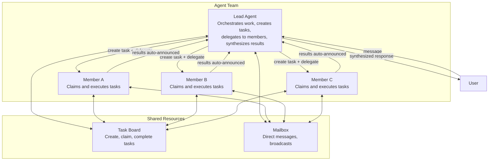
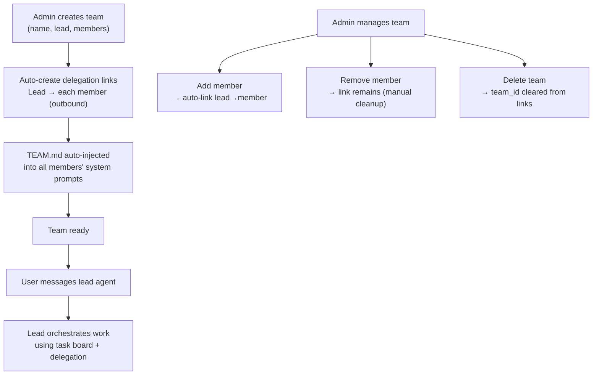
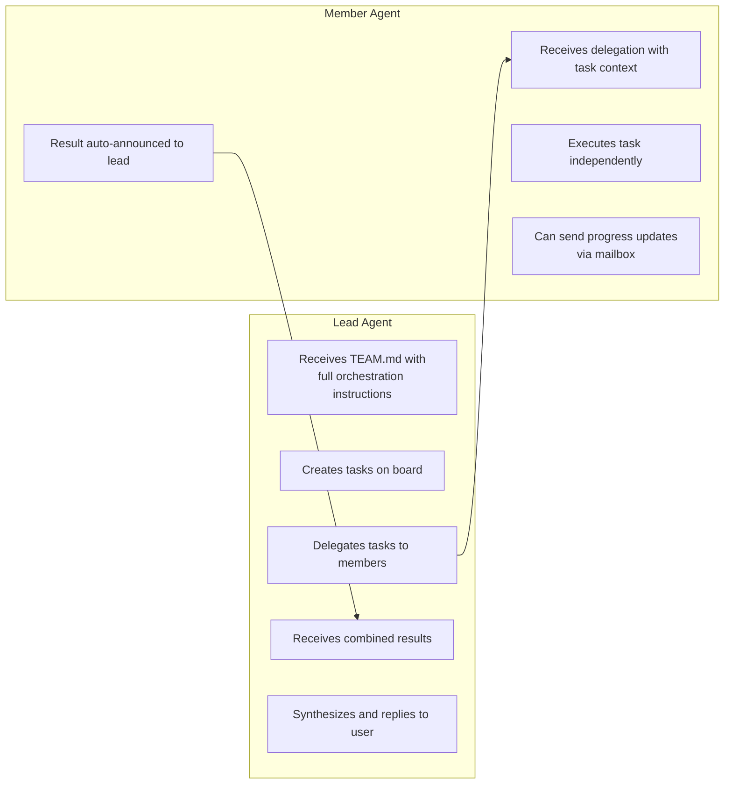
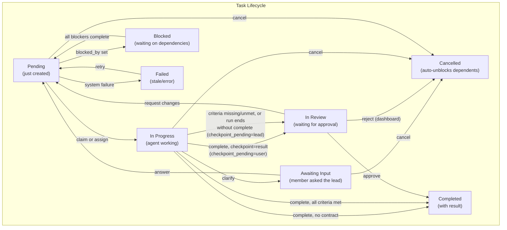
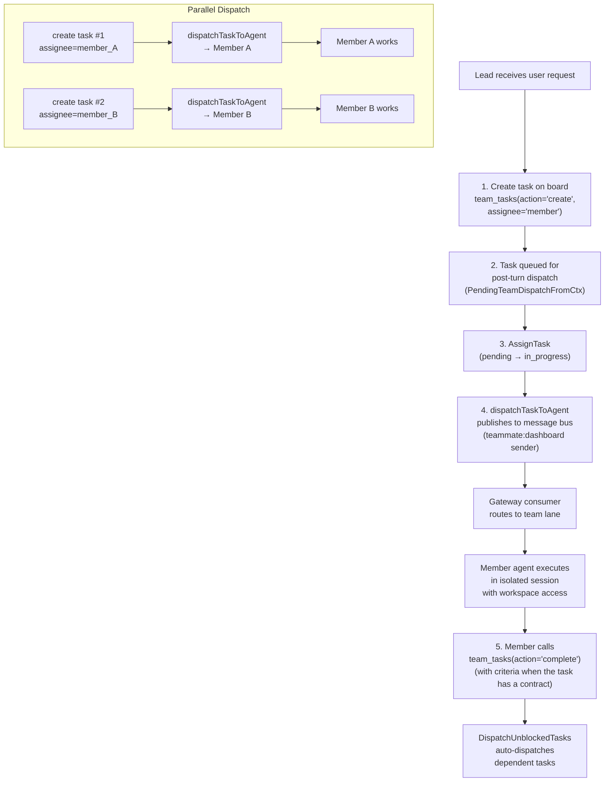
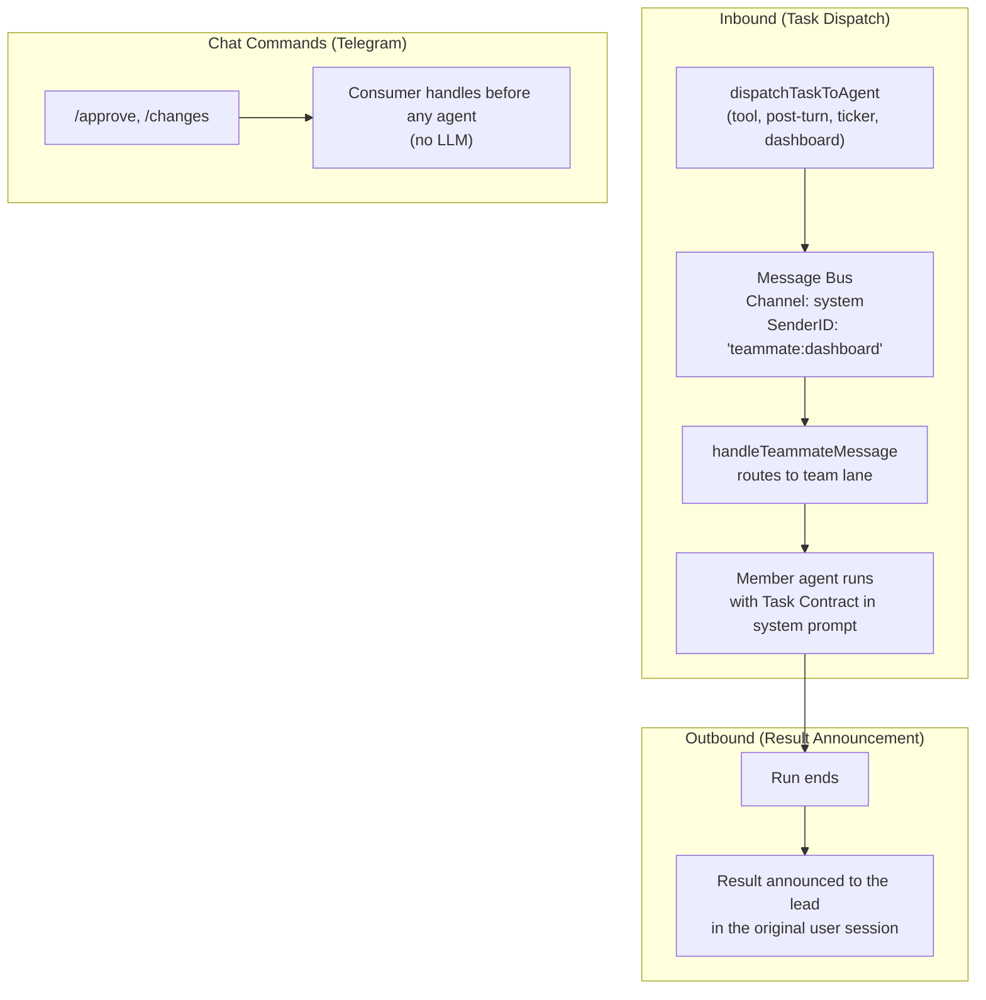

# 11 - Agent Teams

## Overview

Agent teams enable collaborative multi-agent orchestration. A team consists of a **lead** agent and one or more **member** agents. The lead orchestrates work by creating tasks on a shared task board and delegating them to members. Members execute tasks independently and report results back. Communication happens through a built-in mailbox system.

Teams build on top of the delegation system (see [03-tools-system.md](./03-tools-system.md) Section 7) by adding structured coordination: task tracking, parallel work distribution, and result aggregation.

---

## 1. Team Model



### Key Design Principles

- **Lead-centric**: Only the lead receives `TEAM.md` in its system prompt with full orchestration instructions. Members discover context on demand through tools — no wasted tokens on idle agents.
- **Mandatory task tracking**: Every delegation from a lead must be linked to a task on the board. The system enforces this — delegations without a `team_task_id` are rejected.
- **Auto-completion**: When a delegation finishes, its linked task is automatically marked as complete. No manual bookkeeping required.
- **Parallel batching**: When multiple members work simultaneously, results are collected and delivered to the lead in a single combined announcement.

---

## 2. Team Lifecycle



### Creation Process

1. Resolve lead agent by key or UUID
2. Resolve all member agents
3. Create team record with `status=active`
4. Add lead as member with `role=lead`
5. Add each member with `role=member`
6. Auto-create outbound agent links from lead to each member (direction: outbound, max_concurrent: 3, marked with `team_id`)
7. Invalidate agent router caches so TEAM.md is injected on next request

When a member is added later, the same auto-linking happens. Links created by team setup are tagged with `team_id` — this distinguishes them from manually created delegation links.

---

## 3. Lead vs Member Roles

The lead and members have fundamentally different responsibilities and tool access.



### What the Lead Sees (TEAM.md)

The lead's system prompt includes a `TEAM.md` section containing:

- Team name and description
- Complete list of teammates with their roles and expertise (from `frontmatter`)
- **Mandatory workflow instructions**: always create a task first, then delegate with the task ID
- **Orchestration patterns**: sequential (A→B), iterative (A→B→A), parallel (A+B→review), mixed
- **Communication guidelines**: notify user when assigning work, share progress on follow-up rounds

### What Members See (TEAM.md)

Members get a simpler version:

- Team name and teammate list
- Instructions to focus on executing delegated work
- How to send progress updates to the lead via mailbox
- Available task board actions (list, get, search — no create/delegate)

---

## 4. Task Board

The task board is a shared work tracker accessible to all team members via the `team_tasks` tool.



### Actions

| Action | Description | Who Uses It |
|--------|-------------|-------------|
| `create` | Create task with subject, description, priority, assignee, blocked_by, optional `contract` (required when the team enables `task_contract`, see §5) and `require_approval` | Lead/Admin |
| `claim` | Atomically claim a pending task | Members |
| `complete` | Mark task done with result summary, optional `deliverables` (final file paths to send to the user) and `criteria` (`[{index, met, evidence}]`, one per acceptance criterion of the contract) | Members/Agents |
| `clarify` | Owner asks the lead a question (`text`, `kind`: `question` or `missing_tool`); task moves to `awaiting_input` instead of failing | Members (Standard only) |
| `answer` | Lead answers a `clarify` question (`task_id`, `text`, optional `assignee` to hand the task to another member); task is dispatched again | Lead (Standard only) |
| `approve` | Approve an `in_review` task. Refused for every agent when the task waits for the user (`checkpoint_pending=user`) | Lead |
| `reject` | Send an `in_review` task back with a reason. With an owner the task is reset and re-dispatched (the reason becomes a `changes_requested` amendment when there is a contract). Refused when the task waits for the user | Lead |
| `cancel` | Cancel task with reason | Lead |
| `assign` | Admin-assign a pending task to an agent | Admin |
| `review` | Submit task for review, transitions to in_review status | Members |
| `comment` | Add comment to task | All |
| `progress` | Update task progress (percent, step) | Members |
| `list` | List tasks (filter: active/in_review/completed/all, page) | All |
| `get` | Get full task detail with comments, events, attachments | All |
| `search` | Full-text search over subject + description | All |
| `attach` | Attach workspace file to task | Members |
| `ask_user` | Set periodic reminder sent to user for decision | Members |
| `clear_ask_user` | Cancel a previously set ask_user reminder | Members |
| `retry` | Re-dispatch stale or failed tasks back to pending | Admin |
| `update` | Update task metadata (priority, description, etc.) | Lead |

The Lite edition (`LiteTeamPolicy` in `internal/tools/team_action_policy.go`) blocks `comment`, `review`, `approve`, `reject`, `attach`, `ask_user`, `clear_ask_user`, `clarify` and `answer`.

### Atomic Claiming

Two agents grabbing the same task is prevented at the database level. The claim operation uses a conditional update: `SET status = 'in_progress', owner = agent WHERE status = 'pending' AND owner IS NULL`. One row updated means claimed; zero rows means someone else got it first. No distributed mutex needed.

### Blocker Escalation

Members can flag themselves as blocked on a task by adding a blocker comment:

```
team_tasks(action="comment", task_id="...", text="Cannot find API documentation", type="blocker")
```

When a blocker comment is posted:
1. The comment is saved with `comment_type='blocker'`
2. The task is **auto-failed** (status: in_progress → failed)
3. An `EventTeamTaskFailed` is broadcast:
   - Member's session is cancelled via scheduler
   - Chat channel receives "❌ Task failed" notification
   - Web UI dashboard updates in real-time
4. The **lead agent receives an escalation message** from `system:escalation` with:
   - Blocked member name
   - Task number and subject
   - Blocker reason
   - Instructions to retry with `team_tasks(action="retry", task_id="...")`

Blocker escalation is **enabled by default** but can be disabled per-team via settings:
```json
{
  "blocker_escalation": {
    "enabled": false
  }
}
```

When disabled, blocker comments are saved but do not trigger auto-fail or escalation.

### Task Dependencies & Blocking

Tasks can declare `blocked_by` — a list of prerequisite task IDs. When a task has blocking dependencies:
- Task enters `blocked` status (distinct from `pending`)
- Task remains blocked until ALL prerequisites are completed
- When a blocking task completes, all dependent tasks with now-satisfied blockers automatically transition from `blocked` → `pending`
- Cancelled tasks (via `cancel` or `reject`) also unblock their dependents
- Failed tasks do **not** unblock their dependents: they stay `blocked` until the lead retries the failed task (and it completes) or cancels it. The failure notice to the lead lists the tasks still blocked

The `blocked` status is one of 9 possible statuses: `pending`, `in_progress`, `awaiting_input`, `in_review`, `completed`, `failed`, `cancelled`, `blocked`, `stale`.

### Task Data Model

| Field | Description |
|-------|-------------|
| `id`, `team_id` | Unique ID + team ownership |
| `subject`, `description` | Task title and details |
| `status` | pending, in_progress, awaiting_input, in_review, completed, failed, cancelled, blocked, stale |
| `priority` | Integer (higher = more important) |
| `owner_agent_id` | Agent currently working on task |
| `created_by_agent_id` | Agent that created the task (if auto-created by agent) |
| `blocked_by` | List of task IDs this task depends on |
| `task_type` | `general` (default), `request`, `note`, `delegation`, `escalation` |
| `task_number` | Human-readable sequential number (team-local) |
| `progress_percent`, `progress_step` | Current progress tracking |
| `metadata` | Custom JSON for task snapshots, peer_kind, local_key, team_workspace, plus `contract`, `checkpoint`, `checkpoint_pending`, `acceptance_report`, `dispatch_count` (see [06-store-data-model.md](./06-store-data-model.md#task-status-and-metadata-keys)) |
| `user_id`, `chat_id`, `channel` | Scope: which user/group triggered this task |
| `result` | Result summary when completed |

### Task Snapshots

Completed tasks automatically store snapshots in metadata for UI board visualization:

```json
{
  "snapshot": {
    "completed_at": "2026-03-16T12:34:56Z",
    "result_preview": "First 100 chars of result...",
    "final_status": "completed",
    "ai_summary": "Brief AI-generated summary of what was accomplished"
  }
}
```

The board displays these snapshots in a visual timeline, allowing users to review completed work at a glance.

### Delegate Agent Restrictions

Guards that previously prevented delegate agents from directly completing, cancelling, or approving/rejecting tasks are currently commented out (reserved for a future reviewer workflow). At this time, these restrictions are not enforced at runtime. A future implementation may re-enable them when a structured reviewer/approval flow is introduced.

### Assignee is Mandatory

When creating a task via `team_tasks(action="create")`, the `assignee` field is **required**. This specifies which team member should handle the task. If omitted, error: `"assignee is required — specify which team member should handle this task"`

### Concurrent Creation Guard

Agents must check existing tasks before creating new ones. This prevents duplicate task creation in concurrent sessions. The preferred method is `team_tasks(action="search", query="<keywords>")` which uses semantic + keyword matching and saves tokens vs listing all. Alternatively `action="list"` shows the full board. When an agent calls `create` without first checking:
- Error: `"You must check existing tasks first. Call team_tasks(action='search', query='<keywords>') to check for similar tasks before creating — this saves tokens vs listing all."`

### Auto-Claiming Behavior

When an agent calls `complete` on a `pending` task, the task is **automatically claimed first**. This saves an extra tool call:
1. Agent calls `complete` on task in `pending` status
2. System atomically claims the task (pending → in_progress, assign to agent)
3. System marks as `completed`
4. Returns success in one action

This is safe because the claim is atomic — only one agent can succeed.

### User & Channel Scoping

- **System/teammate channels**: See all tasks for the team
- **Regular user channels**: Filter to tasks they triggered (filtered by user ID)
- **Scope discovery**: `teams.scopes` lists all unique channel+chatID scopes across tasks
- **Known users**: `teams.known_users` lists distinct user IDs from team member sessions (UI user select)
- **Pagination**: 30 tasks per page for lists
- **Result truncation**: 8,000 characters for `get`, 500 characters for search snippets

### Comments, Events & Attachments

#### Task Comments

Humans and agents can add comments to provide feedback or clarification:

- `handleTaskComment` (human adds comment via dashboard)
- Comments stored with author ID (agent_id or user_id), creation timestamp
- Emits `EventTeamTaskCommented` event
- Visible in task detail page

#### Task Events

Audit trail of all task state changes:

- Event types: `created`, `assigned`, `completed`, `approved`, `rejected`, `commented`, `failed`, `cancelled`, `stale`, `recovered`
- Each event records actor type (agent or human), actor ID, timestamp, and optional metadata
- Used for compliance audits and UI activity timeline

#### Task Attachments

Workspace files can be attached to tasks:

- Attach action links workspace file (by file ID) to task
- Auto-links files created during task execution
- Metadata captures which agent/user attached the file

#### Task Deliverables

`team_tasks(action="complete", deliverables=[...])` declares which files are the
final output for the user. This is what decides delivery, not what the member's
tools happened to produce:

- Only the task owner or the team lead can declare deliverables. This does not change
  who can complete a task.
- Deliverables can only be declared from the member run working on that task, since
  that run's announce is what sends them. A call from anywhere else, such as a lead
  run, is rejected before the task changes, and the model is told to use `send_file`.
- Paths are validated like `send_file` (inside the workspace, not an internal file,
  regular, not a hardlink, non-empty). One bad path rejects the call and the task
  stays open, so the model can correct it.
- Valid files are tagged `metadata.role="deliverable"` in `team_task_attachments`,
  including files already attached automatically. Only `MarkTaskDeliverables` writes
  this tag.
- Right before sending, each file is checked again. If it or a parent folder was
  swapped for a symlink or hardlink since validation, it is not sent, a
  `security.deliverable_rejected` line is logged, and the announce tells the lead.
- The completion announce attaches deliverables and any `send_file` files to the
  lead's reply automatically. The lead needs no tool call. Deliverables still go out
  if the run fails after the task was completed.
- An announce sends only the files its own run declared. Files declared by an
  earlier run of the same task, for example before a retry, are not sent again.
- If the attachment list cannot be read, the announce says so, so the lead can check
  the task.
- In a run with an assigned task, `create_image`, `create_video`, `create_audio` and
  `tts` output is attached to the task but not sent, since it may be a draft. Chat
  runs outside a task still send it automatically. Images a model generates natively,
  without a tool, are still sent: the member has no path to declare for them.
- With nothing declared and nothing sent, no file goes out. The announce lists the
  attachment paths and tells the lead, who can use `send_file`.

### Review Workflow

A task reaches `in_review` in three ways:

- The member calls `review` (submit for review). The lead or a dashboard user approves or rejects it.
- The task has a contract and the member's `complete` misses a criterion, reports one as not met, or the run ends without `complete`. The task waits for the lead with `checkpoint_pending=lead` (see §5).
- The task carries the result checkpoint and every criterion is met. It waits for the user with `checkpoint_pending=user` (see §5, User Approval).

`require_approval: true` on `create` no longer creates a task in `in_review` before it runs: it sets the result checkpoint, so the task runs first and the user approves the result.

From the dashboard, **Approve** calls `teams.tasks.approve`, **Request changes** calls `teams.tasks.request-changes` (the reason is required, becomes an amendment, and the task is redone), and **Cancel** / `teams.tasks.reject` drops the task (`cancelled`, dependents unblocked).

---

## 5. Task Contract and User Approval

### Task Contract

A Task Contract is a structured definition of a task stored in `team_tasks.metadata.contract` (type `tools.TaskContract`, `internal/tools/team_task_contract.go`). It is enabled per team with the setting `task_contract: {enabled: true}` (default off, Standard edition only).

| Field | Required | Notes |
|-------|----------|-------|
| `objective` | Yes | Why the work matters, tied to the user's request |
| `deliverables` | Yes, at least 1 | What to produce, format, where to put it |
| `acceptance` | Yes, at least 1 | Criteria anyone can check |
| `scope_in`, `scope_out`, `inputs` | No | Lists |
| `on_unclear` | No | `ask` (default) or `assume_and_note` |
| `needs` | No | Tool groups or tool names; assigning to a member without all of them is rejected, listing the members that have them |
| `checkpoint` | No | `""` or `result` (user approves the result, see below) |
| `limits.max_iterations` | No | Lowered to the assignee's own `max_tool_iterations` |
| `version`, `amendments` | System-written | Amendment kinds: `answer`, `changes_requested`, `reassigned` |

Limits: each string ≤ 2000 characters, each list ≤ 20 items, at most 20 amendments.

When the team enables `task_contract`, every task type except `request` and `note` needs a valid contract before it is assigned or dispatched (`create` with an assignee, `assign`, `retry`). A task created without an assignee can still be created without one and is blocked at assignment. Teams without the setting behave as before.

**At dispatch** the member's run gets a "Task Contract" block in its system prompt (`RunRequest.ExtraSystemPrompt`, rendered by `tools.RenderTaskContract`), with the task number, version, objective, deliverables, numbered acceptance criteria, scope and every amendment. The block is the authoritative task definition even after reject, retry or summarised history.

**At completion** the member calls `complete` with `criteria=[{index, met, evidence}]`, one entry per criterion. The report is stored in `metadata.acceptance_report`. All met: the task completes (or waits for the user when it carries the result checkpoint). Missing, unmet, or a run that ends without `complete`: the task stays `in_review` with `checkpoint_pending=lead` for the lead to approve or send back.

**Clarify and answer** (Standard): a member that lacks information calls `clarify`. The question is stored as a task comment (`Question: …` or `Missing tool: …`), the task moves to `awaiting_input`, the lead is notified and reminders go to the original chat. The lead answers with `answer` (or a dashboard user with `teams.tasks.answer`); the answer becomes an `answer` amendment and the task is dispatched again to the owner, or to `assignee` (a `reassigned` amendment).

### User Approval

For work the user must sign off, the lead marks the task with the result checkpoint (`contract.checkpoint: "result"` or `require_approval: true`). The checkpoint only takes effect when the task comes from a channel that approves by command and has it turned on:

- Channel setting: `task_approval: {enabled: true}` in the Telegram channel instance config (default off). Only channels implementing `channels.TaskApprovalCapable` support it; currently Telegram only. In the Web UI it is the "Approve team tasks by command" switch on the Telegram channel form.
- If the origin channel does not approve by command, the checkpoint is dropped at `create` and the lead is told it will review the result itself. Tasks created from the dashboard never keep the checkpoint.

When the member completes with every criterion met, the task stays `in_review` with `checkpoint_pending=user` and a message asks the user in the original chat. The user answers there:

| Command | Effect | Who may use it |
|---------|--------|----------------|
| `/approve <task number>` | Accept the result; task becomes `completed` | The user who made the request (`origin_sender_id`) or a file writer of the group |
| `/changes <task number> <reason>` | Request changes; the reason becomes a `changes_requested` amendment and the task is redone | Same |

Commands are handled by the gateway consumer before any agent, without the LLM, and only in the task's original chat. The same task can also be approved or sent back on the dashboard.

**Why agents cannot approve for the user:** `approve` and `reject` in the `team_tasks` tool always refuse a task with `checkpoint_pending=user`, whichever agent calls them and on whichever channel, and the MCP bridge applies the same guard. The guard is written into the tool rather than a configurable hook, because hooks can be disabled or time out to "allow".

---

## 6. Team Workspace

Each team has a shared workspace for storing files produced during task execution. Workspace scoping is configurable per team.

### Workspace Modes

| Mode | Directory Structure | Use Case |
|------|-------------------|----------|
| **Isolated** (default) | `{dataDir}/teams/{teamID}/{chatID}/` | Per-conversation file isolation; each user/chat has own folder |
| **Shared** | `{dataDir}/teams/{teamID}/` | All team members access same folder; no user/chat isolation |

Configure via team settings `workspace_scope: "shared"` (default: `"isolated"`).

### Workspace Access

Team members have file tools access to their team workspace:

- **Read**: List files, read file content
- **Write**: Create and update files (auto-linked to task)
- **Delete**: Remove files from workspace

When a member writes a file during task execution, it's automatically:
1. Stored in team workspace with metadata
2. Linked to the active task (task_id)
3. Visible to other team members on task detail page

### WorkspaceDir Context

During task dispatch, tool context is injected with the team workspace path, team ID, active task ID, and the task's origin channel and chat ID. File tools use this context to resolve workspace paths and auto-link created files to the active task.

### Quota & Limits

| Limit | Value |
|-------|-------|
| Max file size | 10 MB |
| Max files per scope | 100 |
| Directory creation | Automatic (0750 permissions) |

---

## 7. Task Dispatch Integration

Teams use a task-board-driven dispatch model. The lead creates tasks with an assignee; the system auto-dispatches to the assigned member agent via the message bus. The legacy `spawn(agent=..., team_task_id=...)` flow has been removed — `spawn` now only supports self-clone subagents.



### Dispatch Mechanism

Task dispatch uses `dispatchTaskToAgent()` (`team_tool_dispatch.go`) which publishes an inbound message via the message bus:

- **Post-turn dispatch** (default): Tasks created during a lead's turn are queued via `PendingTeamDispatchFromCtx` and dispatched after the turn ends. This avoids race conditions with `blocked_by` setup.
- **Fallback dispatch**: If no post-turn hook is available (e.g., HTTP API context), the task is assigned and dispatched immediately.
- **Routing**: Uses `task.Channel`/`task.ChatID` as primary source, falling back to context values for initial dispatch.

### Spawn Rejection

The `spawn` tool no longer accepts an `agent` parameter. If an LLM attempts `spawn(agent="member")`, it receives an error directing it to use `team_tasks(action="create", assignee="member")` instead.

### Dispatch Safety

- **Lead self-dispatch guard**: Tasks assigned to the lead agent are auto-failed (prevents dual-session loop).
- **Circuit breaker**: Tasks auto-fail after 3 dispatch attempts (`maxTaskDispatches`). Prevents infinite loops when agents can't complete a task.
- **Dispatch count tracking**: Each dispatch increments `metadata.dispatch_count`. An explicit `retry` or `reject` resets it to 0, so the breaker only counts re-dispatches caused by failures.
- **Visible failures**: When agent-side dispatch (the `team_tasks` tool, post-turn dispatch and the task ticker) fails — lead guard, circuit breaker, unknown agent, full inbound queue — it marks the task `failed`, broadcasts `team.task.failed` and notifies the lead. If the inbound queue is full, the lead notice is retried in the background. Dispatch started from the dashboard (`teams.tasks.*` RPCs) uses a separate code path that does not yet do this.
- **Recovery re-dispatch**: When the task ticker resets tasks with expired locks to `pending` (or unblocks orphaned tasks), it dispatches them again in the same tick. Pending tasks queued behind a busy owner are not marked `stale`.
- **Owner check**: Only the task owner or the lead can `complete` a task. `approve` and `reject` through the tool always require the lead and are refused for tasks waiting for the user (`checkpoint_pending=user`); dashboard users use the `teams.tasks.approve`, `teams.tasks.request-changes` and `teams.tasks.reject` RPCs.
- **Contract gate**: When the team enables `task_contract`, assigning or retrying a task of a type other than `request`/`note` without a valid contract is rejected, and a contract with `needs` is rejected for an assignee that lacks those tools.

### Completion

When a member calls `team_tasks(action="complete")`:

1. **Task without a contract**: marked `completed` with the result summary. A run that ends without `complete` is completed automatically.
2. **Task with a contract**: the `criteria` report is checked against `contract.acceptance`. All met → `completed`, or `in_review` with `checkpoint_pending=user` when the task carries the result checkpoint. Missing or unmet criteria, or a run that ends without `complete` → `in_review` with `checkpoint_pending=lead`; the task is never auto-completed.
3. Files created during execution are auto-linked to the task, and workspace events are recorded.
4. On `completed`, `DispatchUnblockedTasks` runs — pending tasks with satisfied blockers are auto-dispatched, one task per owner per round (priority-ordered).

### Unblocked Task Dispatch

`DispatchUnblockedTasks()` runs after task completion/cancellation:

- Finds pending tasks with assigned owners (ordered by priority DESC)
- Dispatches highest-priority task per owner (one at a time)
- Appends completed blocker results and recent comments to dispatch content
- Restores leader's trace context from task metadata for proper trace linking
- Remaining tasks stay pending until the current one completes

### Dispatch Content

Each dispatched task includes in its message to the member:

- Task number, ID, subject, and description
- Team workspace path (if configured)
- List of attached files (from task metadata)
- Instructions for available actions: progress, comment, blocker, complete (with `deliverables`)
- Completed blocker results (for unblocked tasks)
- Recent comments (for re-dispatched tasks after reject/retry)

The Task Contract is **not** only in the dispatch message: it is injected into the member's system prompt for that run (see §5), because the member session is shared across tasks and long history is summarised. Its `limits.max_iterations` lowers the run's `RunRequest.MaxIterations`.

---

## 8. TEAM.md — System-Injected Context

`TEAM.md` is a virtual file generated at agent resolution time. It is not stored on disk or in the database — it's rendered dynamically based on the current team configuration and injected into the system prompt wrapped in `<system_context>` tags.

### Generation Trigger

During agent resolution, if the agent belongs to a team:
1. Load team data
2. Load team members
3. Generate TEAM.md with role-appropriate content
4. Inject as a context file

### Content Differences

| Section | Lead | Member |
|---------|------|--------|
| Team name + description | Yes | Yes |
| Teammate list with roles | Yes | Yes |
| Mandatory workflow (create→delegate) | Yes | No |
| Orchestration patterns | Yes | No |
| Communication guidelines | Yes | No |
| Task board actions (full) | Yes | Limited |
| "Task Contract (required)" guide with example (team enables `task_contract`) | Yes | No |
| "Member Questions": how to `answer` a `clarify`, never approve a task waiting for the user (Standard) | Yes | No |
| "Just do the work" instructions | No | Yes |
| Progress update guidance | No | Yes |
| Contract rules: the contract block is authoritative; complete with `criteria` (team enables `task_contract`) | No | Yes |

### Orchestration Patterns (Lead Only)

The lead's TEAM.md describes three orchestration patterns:

- **Sequential**: Member A finishes → lead reviews → delegates to Member B with A's output
- **Iterative**: Member A drafts → Member B reviews → back to A with feedback
- **Mixed**: Members A+B work in parallel → lead reviews combined output → delegates to C

### Negative Context Injection

If an agent is NOT part of any team, the system injects negative context:
- "You are NOT part of any team. Do not use team_tasks tool."

This prevents wasted LLM iterations probing unavailable capabilities.

---

## 9. Message Routing

Team messages flow through the message bus with specific routing rules.



### Routing Prefixes

| Prefix | Source | Destination | Scheduler Lane |
|--------|--------|-------------|----------------|
| `teammate:` | Task dispatch (`SenderID: "teammate:dashboard"` on the `system` channel) | Assigned member's session | team |
| `delegate:` | Legacy session key format kept for existing delegation sessions | Parent agent's original session | team |

### Session Context Preservation

When a delegation or team task completes, the result is routed back to the **original user session** (not a new session). This is achieved through metadata propagation:

- `origin_channel`: The channel where the user sent the message (e.g., telegram)
- `origin_peer_kind`: DM or group context
- `origin_local_key`: Thread/topic context for correct routing (e.g., forum topic ID)

This ensures results land in the correct conversation thread, even in Telegram forum topics or Feishu thread discussions.

---

## 10. Access Control

Teams support fine-grained access control through team settings.

### Team-Level Settings

| Setting | Type | Description |
|---------|------|-------------|
| `allow_user_ids` | String list | Only these users can trigger team work |
| `deny_user_ids` | String list | These users are blocked (deny takes priority) |
| `allow_channels` | String list | Only messages from these channels trigger team work |
| `deny_channels` | String list | Block messages from these channels |
| `workspace_scope` | String | "isolated" (default) or "shared" — file scope mode |
| `workspace_quota_mb` | Integer | Max workspace size in MB (optional) |
| `progress_notifications` | Boolean | Emit progress_notification events |
| `followup_interval_minutes` | Integer | Ask_user reminder interval |
| `followup_max_reminders` | Integer | Max ask_user reminders before escalation |
| `escalation_mode` | String | How to escalate stale tasks: "notify_lead", "fail_task" |
| `escalation_actions` | String list | Actions to take on escalation |
| `blocker_escalation` | Object | Blocker comment escalation settings: `{enabled: true}` (default enabled) |
| `member_requests` | Object | `{enabled, auto_dispatch}`: members may create `request` tasks; `auto_dispatch` skips the lead's review |
| `task_contract` | Object | `{enabled: false}` by default. When on, tasks of every type except `request` and `note` need a contract before assignment (see §5). Standard edition only; toggled in Team Settings → Task Contract |

Channel-level: the Telegram channel instance setting `task_approval: {enabled}` (default off) lets users approve results with `/approve` and `/changes` (see §5, User Approval).

System channels (`teammate`, `system`) always pass access checks. Empty settings mean open access.

### Link-Level Settings

Each delegation link (lead→member) has its own settings:

| Setting | Description |
|---------|-------------|
| `UserAllow` | Only these users can trigger this specific delegation |
| `UserDeny` | Block these users from this delegation (deny takes priority) |

### Concurrency Limits

| Layer | Scope | Default |
|-------|-------|---------|
| Per-root agent | Executing self-spawn descendants across the full tree | 20 |
| Process safety cap | Executing self-spawn and Agent Link callbacks | Standard 32 / Lite 2 |
| Pending admission | Independent child-run chains waiting for capacity | 128 |

Each Agent Link delegation begins a new target-owned spawn tree. The source
agent's `maxSpawnDepth` does not limit the target agent; any subagents created by
the target use the target's own subagent settings.

`agent_links.max_concurrent` remains serialized compatibility metadata and is
not currently an admission limit. Agent Team task scheduling keeps its existing
lane/workspace contract.

---

## 11. Agent Links & Delegation Graph (v3)

Agent links define directed delegation relationships between agents, separate from team membership. Each link tracks:
- **Source agent** (can delegate to)
- **Target agent** (can receive delegations from)
- **Direction** (outbound from source, inbound to target)
- **Team context** (optional `team_id` if created by team setup)
- **Reserved concurrency metadata** (`max_concurrent`; retained for compatibility, not currently enforced)

**Team-created links** are automatically created when a team is set up (lead → each member). Links remain even if the team is deleted or members are removed, allowing manual cleanup.

**Delegation graph visibility** — agents can query available delegation targets via the delegation system. The graph determines which agents appear in the `spawn` tool's available targets.

## 12. Delegation Context

### Authorization and artifact scope

Agent Link dispatch preserves the caller's authorization scope for policy
checks but attenuates filesystem authority. The delegatee receives staged
read-only copies through `inputs/` and writes only to `outputs/`. After the run,
regular-file, path, symlink, count, and size validation completes before an
atomic publication to the caller's `.delegations/<delegation-id>/` directory.
Agent Team shared-workspace behavior is unchanged.

Successful publications persist with `manifest.json` and logical `outputs/...`
entries. Failed/cancelled exchanges are retained for 60 minutes for diagnostics
and removed by a restart-safe janitor whose per-sweep item and filesystem-entry
work are both bounded. Traces correlate by
`delegation_id` and record only logical paths, sizes, hashes, status, and
timestamps—never physical exchange or caller host paths.

Async Agent Link dispatch also creates a durable completion row before the
child-run ticket is activated. The full terminal result and logical published
artifact paths are persisted before the automatic parent announcement. If
bounded announcement retries cannot enter the inbound queue, the source agent
can retrieve the result after the run—or after a gateway restart—with:

```text
delegate(action="get", delegation_id="<uuid>")
```

Retrieval is scoped by tenant and the immutable UUID of the source agent. It
does not grant the target agent, another linked source, or a later same-key
agent access to the result. Delegation completion rows are excluded from
`/subagents` and self-clone roster queries.

Terminal database writes use per-attempt deadlines plus an extended bounded
retry window. If the database remains unavailable for that whole window, the
live announcement is still attempted but is not recorded as durably delivered;
a crash during the same outage may prevent the terminal result from being
recorded. On the next startup that can reach the database, every non-terminal
completion row from the previous process is marked `failed` with an interruption
reason instead of remaining `queued` or `running` forever. The gateway retries
that reconciliation before accepting traffic if the database is temporarily
unavailable. The current runtime assumes one active gateway process. Graceful
shutdown waits for accepted completion persistence before tearing down runtime
dependencies.

### Trace Linking

Delegation traces are linked to the parent trace through `parent_trace_id`. This allows the tracing system to show the full delegation chain: user request → lead processing → member delegation → member execution.

### Workspace & Task Context

Delegation context includes team workspace and task information so member agents can:

1. Access the team workspace directory (if configured)
2. Auto-link files created to the active task
3. Record task progress and comments
4. Route results back to the correct user/chat

Context keys injected:

- `tool_team_id`: Team UUID for the team_tasks tool
- `tool_team_workspace`: Shared workspace directory path (or empty for isolated mode)
- `tool_team_task_id`: Active task UUID for workspace file linking
- `tool_workspace_channel`: Task's origin channel (for routing)
- `tool_workspace_chat_id`: Task's origin chat ID (for routing)

---

## 13. Events

Teams emit events for real-time UI updates and observability (names from `pkg/protocol/events.go`).

| Event | When |
|-------|------|
| `team.task.created` | New task added to board |
| `team.task.claimed` | Member claimed a pending task |
| `team.task.assigned` | Task assigned to agent (admin or auto-assign) |
| `team.task.dispatched` | Task dispatched to its owner, including after `answer` or a change request |
| `team.task.progress` | Progress update |
| `team.task.updated` | Task fields changed; also sent when `clarify` moves the task to `awaiting_input` |
| `team.task.reviewed` | Task moved to `in_review` (submitted, or waiting for the lead or user) |
| `team.task.approved` | Task approved (lead, dashboard or `/approve`) |
| `team.task.rejected` | Task sent back or rejected |
| `team.task.completed` | Task marked as complete |
| `team.task.cancelled` | Task cancelled |
| `team.task.failed` | Task failed (dispatch guard, circuit breaker, error) |
| `team.task.stale` | Task marked stale by the ticker |
| `team.task.commented` | Comment added |
| `team.task.attachment_added` | File attached to a task |
| `team.task.deleted` | Task hard-deleted (terminal status only) |
| `team.created`, `team.updated`, `team.deleted` | Team CRUD |
| `team.member.added`, `team.member.removed` | Membership changes |
| `delegation.started`, `delegation.completed`, `delegation.failed`, `delegation.cancelled` | Agent Link delegation lifecycle |

---

## File Reference

| Module | Path | Purpose |
|---|---|---|
| Gateway RPC methods | `internal/gateway/methods/teams_*.go`, `internal/gateway/methods/agent_links.go` | Team CRUD, task board, workspace, agent links RPC handlers |
| Team tools | `internal/tools/team_*.go`, `internal/tools/subagent_*.go`, `internal/tools/workspace_dir.go`, `internal/tools/context_keys.go` | Task board tool, Task Contract, clarify/answer, approval guard, access policy, delegation execution, workspace helpers |
| Store layer | `internal/store/team_store.go`, `internal/store/pg/teams.go`, `internal/store/agent_link_store.go`, `internal/store/pg/agent_links.go` | Team/task/message persistence, agent link persistence |
| Agent integration | `internal/agent/resolver.go`, `internal/agent/systemprompt_sections.go`, `cmd/gateway_managed.go`, `cmd/gateway_consumer.go` | TEAM.md generation, system prompt injection, message routing |

Use `grep` or your editor's symbol search for specific files.

---

## Cross-References

| Document | Relevant Content |
|----------|-----------------|
| [03-tools-system.md](./03-tools-system.md) | Delegation system, agent links |
| [06-store-data-model.md](./06-store-data-model.md) | Team tables schema, delegation_history |
| [08-scheduling-cron.md](./08-scheduling-cron.md) | Delegate scheduler lane (concurrency 100), cron |
| [09-security.md](./09-security.md) | Delegation security |
